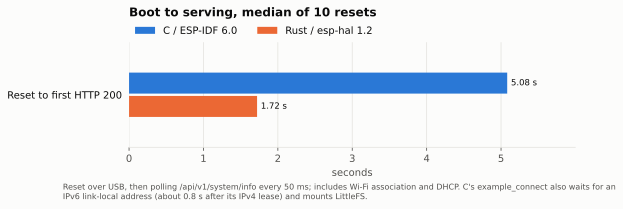

# restful_server C to Rust port

Espressifs 
[restful_server](https://github.com/espressif/esp-idf/tree/master/examples/protocols/http_server/restful_server) 
ported from C (ESP-IDF 6.0) to Rust (esp-hal 1.2.3,
Embassy, picoserve), measured on an ESP32-C6. Full tables: [results/README.md](results/README.md).

| ESP32-C6, same frontend and API | C: ESP-IDF 6.0, FreeRTOS, lwIP | Rust: esp-hal 1.2, Embassy, smoltcp |
|---|---:|---:|
| App image, frontend excluded | 934 KiB | 662 KiB |
| SRAM in use at peak | 254 KiB | 242 KiB |
| Small request, p50 | 19 ms | 13 ms |
| 245 KB file, p50 | 364 ms | 789 ms |
| Full page load, 6 connections, p50 | 1.45 s | 2.24 s |
| Reset to first HTTP 200 | 5.1 s | 1.7 s |
| Clean build / one-file rebuild | 70 s / 7.0 s | 52 s / 8.0 s |
| App source lines | 269 | 323 |
| Dependencies | 79 IDF components | 173 crates |




## Notes

- C fails 2 of 8 checks as shipped. Bad JSON crashes it (NULL dereference, reboot), and it
  stops reconnecting after 7 attempts, so a router reboot leaves it offline. The second is
  fixed here with `CONFIG_EXAMPLE_WIFI_CONN_MAX_RETRY`.
- Rust has no listen backlog. Each task owns one socket, so extra connections are refused.
  It runs 8 tasks to cover a browser's 6.
- Rust is slow on large files. Its TCP send buffer is 4 KiB; 8 KiB gives 578 ms.
- Rust runs Wi-Fi without power save. That is esp-radio's default; IDF uses modem sleep. With
  modem sleep, Rust page loads failed in one run.

## Run

Populate wifi.env from wifi.env.example

```sh
(cd front/web-demo && pnpm install && pnpm build)    # both builds embed dist/
scripts/build_c.sh [flash monitor]                   # HEAP_STATS=1 adds /api/v1/heap
scripts/build_rust.sh [--features heap-stats]        # flash: espflash flash <elf>
scripts/build_rust.sh --no-default-features --target-dir target/noweb   # for measure_static

python3 bench/measure_static.py                      # size, static RAM, source
bench/build_times.sh                                 # hyperfine
bench/http_bench.py check|latency|watch|boot --host <ip> --build c|rust
uv run bench/charts.py                               # figures + results/README.md
```
