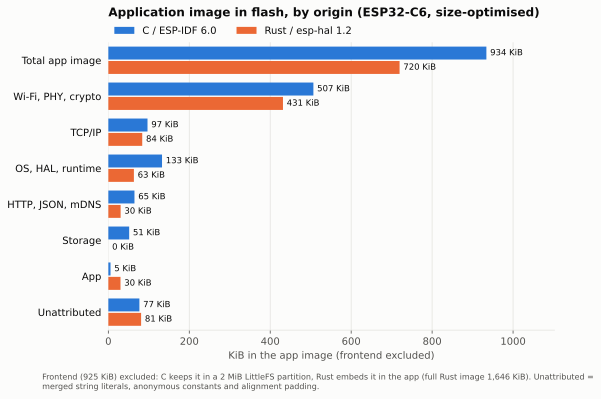
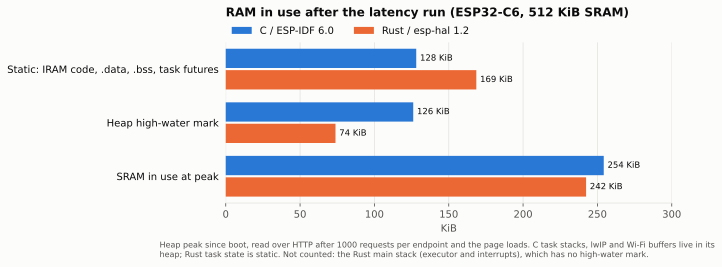
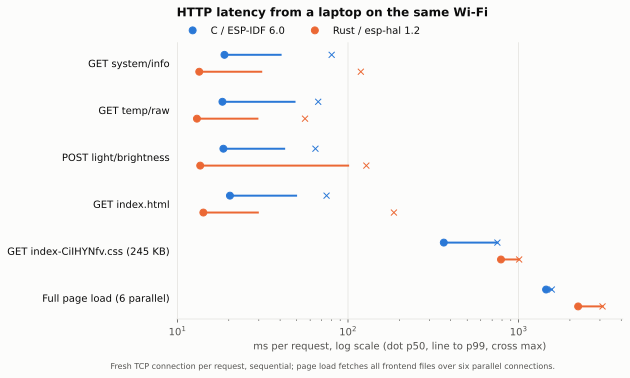

# restful_server: C/ESP-IDF vs Rust/esp-hal

Espressif's `restful_server` example ported from C (ESP-IDF 6.0) to no_std Rust (esp-hal 1.2.3,
Embassy, picoserve), measured on an ESP32-C6. Same frontend, API and mDNS name.
Full tables: [results/README.md](results/README.md).

| | C / ESP-IDF | Rust / esp-hal |
|---|---:|---:|
| App image, frontend excluded | 934 KiB | 662 KiB |
| SRAM in use at peak | 254 KiB | 242 KiB |
| Small request, p50 | 19 ms | 13 ms |
| 245 KB file, p50 | 364 ms | 789 ms |
| Reset to first HTTP 200 | 5.1 s | 1.7 s |
| Clean build | 70 s | 52 s |
| Checklist | 6/8: crashes on bad JSON; no AP recovery as shipped | 8/8 |






## Notes

- **C, bad JSON:** NULL dereference at `rest_server.c:126`, reboot, back in 5.6 s.
- **C, AP reboot:** `example_connect` quits after 7 attempts (~15 s). Fixed here with
  `CONFIG_EXAMPLE_WIFI_CONN_MAX_RETRY`.
- **Rust, no listen backlog:** one smoltcp socket per task, extra connections are refused. 8 tasks
  cover a browser's 6.
- **Rust, client closes first:** socket busy ~1 s (retransmit). The bench waits for the server's
  FIN when told `Connection: close`.
- **Rust, large files:** 4 KiB TCP send buffer; 8 KiB gives 578 ms, the rest is unexplained.
- **Rust, Wi-Fi power save:** off (esp-radio default). `--features ps-min` matches IDF but broke
  page loads in one run.
- **Rust, Wi-Fi security:** WPA2 at most (esp-radio beta.1).
- **API differences:** Rust answers 404 not 500 for unknown files, rejects colours above 255,
  emits compact JSON and reports `esp-hal v1.2.3` as `idf_version`. No NetBIOS.

## Run

Wi-Fi from `WIFI_SSID`/`WIFI_PASSWORD` or a gitignored `wifi.env`; 2.4 GHz, WPA2.

```sh
(cd front/web-demo && pnpm install && pnpm build)    # both builds embed dist/
scripts/build_c.sh [flash monitor]                   # HEAP_STATS=1 adds /api/v1/heap
scripts/build_rust.sh [--features heap-stats]        # flash: espflash flash <elf>
scripts/build_rust.sh --no-default-features --target-dir target/noweb   # for measure_static

python3 bench/measure_static.py                      # size, static RAM, source
bench/build_times.sh                                 # hyperfine
bench/http_bench.py check|latency|watch|boot --host <ip> --build c|rust
uv run bench/charts.py                               # figures + results/README.md
```

WSL2 needs `networkingMode=mirrored` for the mDNS check. esp-hal is pinned `~1.2.2`; re-run on 1.3.
