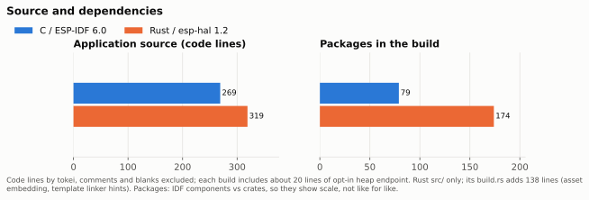
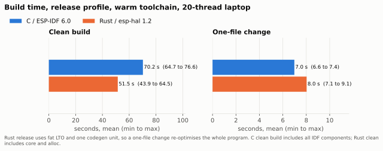
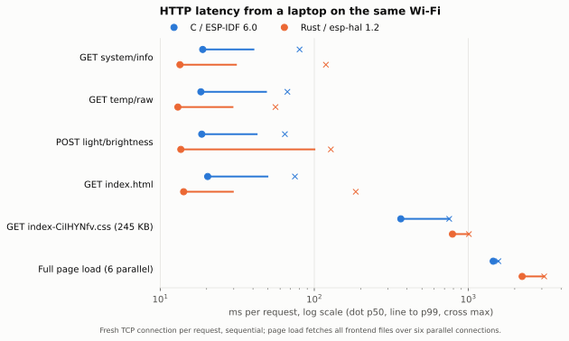
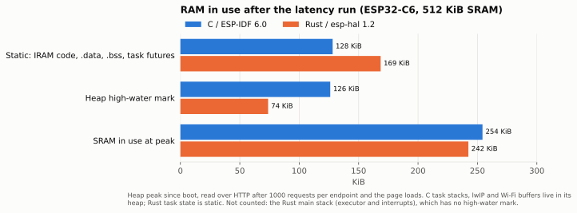

# Results

Generated by `bench/charts.py` from the JSON files in this folder. ESP32-C6, ESP-IDF 6.0 vs esp-hal (Rust: `rustc 1.99.0 (b940084d7 2026-09-28)`).

## Flash

| KiB | C / IDF | Rust / esp-hal |
|---|---:|---:|
| App image, frontend excluded | 934 | 662 |
| Frontend (925 KiB of files) | LittleFS partition, 2,048 reserved | in the app image |
| Flash written by a full flash (app + frontend image) | 2,982 | 1,588 |

## Static RAM

## Source and dependencies

Rust application code has 0 `unsafe` blocks.

## Build time

| seconds, mean (min to max) | C / IDF | Rust / esp-hal |
|---|---:|---:|
| Clean | 70.2 (64.7 to 76.6) | 51.5 (43.9 to 64.5) |
| One-file change | 7.0 (6.6 to 7.4) | 8.0 (7.1 to 9.1) |
| Clean, CPU time (all threads) | 379 | 331 |

## On the device

### Parity checklist

| Check | C / ESP-IDF 6.0 | Rust / esp-hal 1.2 |
|---|---|---|
| GET / serves the frontend | pass | pass |
| GET system/info | pass | pass |
| GET temp/raw | pass | pass |
| POST light/brightness | pass | pass |
| dashboard.local resolves | pass | pass |
| POST bad JSON answers 400 | **fail**: no response: NULL dereference of cJSON_Parse result, Guru Meditation, reboot | pass |
| Serving again after bad JSON | pass | pass |
| Recovers after an access point reboot | **fail** as shipped (example_connect stops after 7 failed attempts, about 15 s); pass with the retry limit raised | pass |

### Latency

| ms, p50 / p99 / max | C / ESP-IDF 6.0 | Rust / esp-hal 1.2 |
|---|---:|---:|
| GET system/info | 19 / 40 / 80 | 13 / 31 / 119 |
| GET temp/raw | 18 / 49 / 67 | 13 / 29 / 56 |
| POST light/brightness | 19 / 42 / 64 | 14 / 100 / 128 |
| GET index.html | 20 / 50 / 75 | 14 / 30 / 186 |
| GET index-CiIHYNfv.css (245 KB) | 364 / 751 / 751 | 789 / 1008 / 1008 |
| Full page load (6 parallel) | 1450 / 1566 / 1566 | 2235 / 3106 / 3106 |

### RAM at run time

| KiB | C / ESP-IDF 6.0 | Rust / esp-hal 1.2 |
|---|---:|---:|
| Heap size | 397 | 100 |
| Heap in use after the run | 91 | 49 |
| Heap high-water mark | 126 | 74 |
| Static in use (no heap arena) | 128 | 169 |

### Boot and recovery

| | C / ESP-IDF 6.0 | Rust / esp-hal 1.2 |
|---|---:|---:|
| Reset to first HTTP 200, median of 10 (s) | 5.08 | 1.72 |
| Access point reboot | recovered, down 103 s, 0.0 s after the router | recovered, down 84 s, 0.0 s after the router |

Recovery time is measured against the router's own web interface coming back, so it resolves only to the 0.5 s poll.
