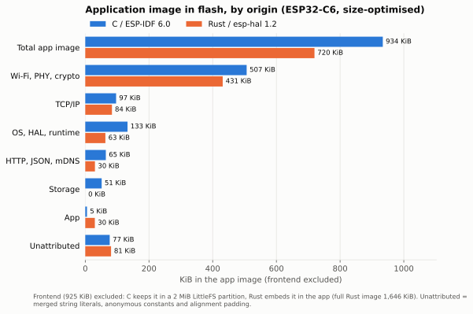
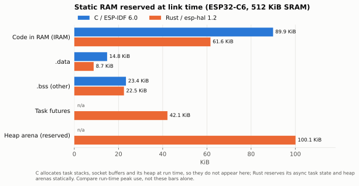

# Results

Generated by `bench/charts.py` from the JSON files in this folder. ESP32-C6, ESP-IDF 6.0 vs esp-hal (Rust: `rustc 1.99.0 (b940084d7 2026-09-28)`).

## Flash

| KiB | C / IDF | Rust / esp-hal |
|---|---:|---:|
| App image, frontend excluded | 934 | 720 |
| Frontend (925 KiB of files) | LittleFS partition, 2,048 reserved | in the app image |
| Flash written by a full flash (app + frontend image) | 2,982 | 1,646 |

## Static RAM

## Source and dependencies

Rust application code has 0 `unsafe` blocks.

## Build time

| seconds, mean (min to max) | C / IDF | Rust / esp-hal |
|---|---:|---:|
| Clean | 70.2 (64.7 to 76.6) | 51.5 (43.9 to 64.5) |
| One-file change | 7.0 (6.6 to 7.4) | 8.0 (7.1 to 9.1) |
| Clean, CPU time (all threads) | 379 | 331 |

## On the device

Not measured yet: needs a board. See the top-level README.
